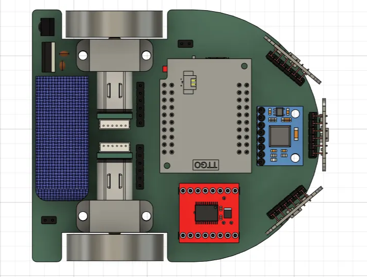

# Moratinho

Repositório dedicado ao micromouse da equipe

# Relação Pino-Função

| **Pinos**                             | **Componentes**            |
| ------------------------------------- | -------------------------- |
| **D22, D21, D19**                     | **VL53L0X FRONTAL**        |
| **D22, D21, D23**                     | **VL53L0X ESQUERDO**       |
| **D22, D21, D18**                     | **VL53L0X DIREITO**        |
| **D35[^1], VN[^1] (D39)**             | **Encoder motor direito**  |
| **D34[^1], D33**                      | **Encoder motor esquerdo** |
| **D22, D21**                          | **MPU6050**                |
| **D05**                               | **Receptor IR**            |
| **D26, D32, D04, D16(RX2), D27, D25** | **Ponte H**                |

### [^1]: Input only - 34, 35, VP, VN

# Dependencias:

No projeto foi utilizada as bibliotecas: 
[BluetoothSerial](https://github.com/hen1227/bluetooth-serial) 
[ESP32Encoder](https://github.com/madhephaestus/ESP32Encoder) 
[IRremote](https://github.com/Arduino-IRremote/Arduino-IRremote) 
[VL53L0X](https://github.com/pololu/vl53l0x-arduino) 
